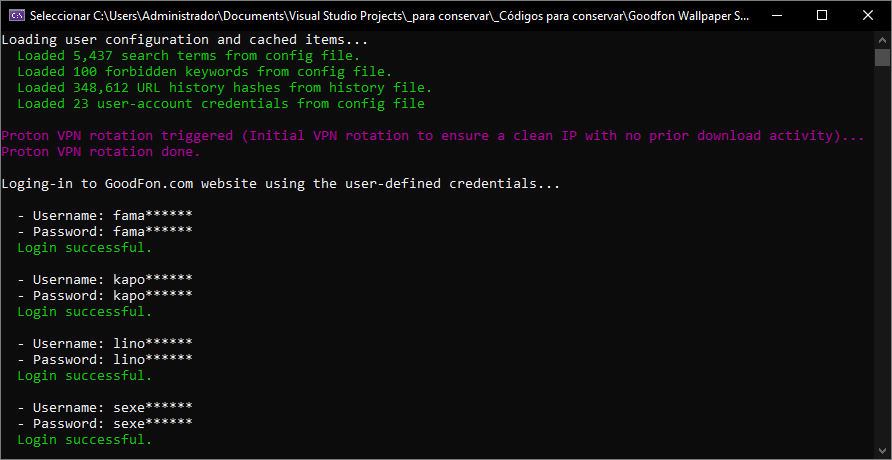
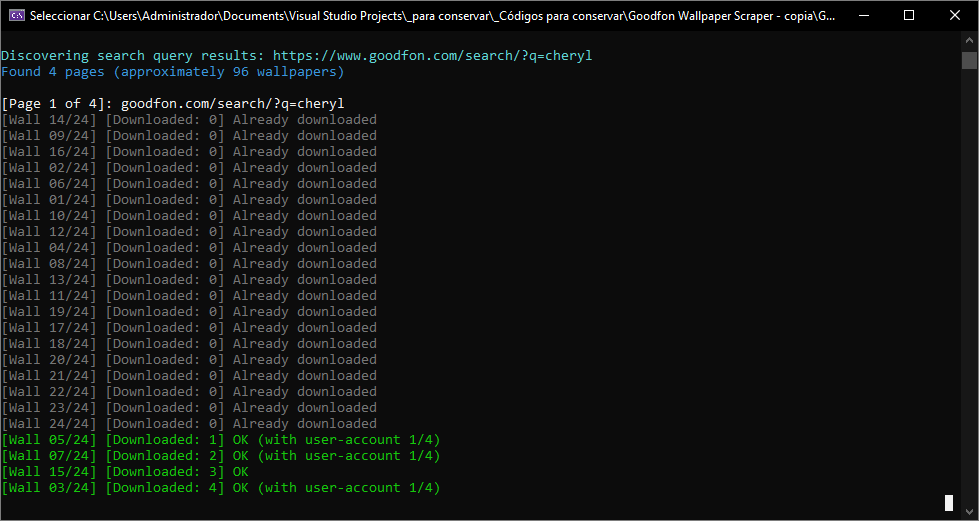
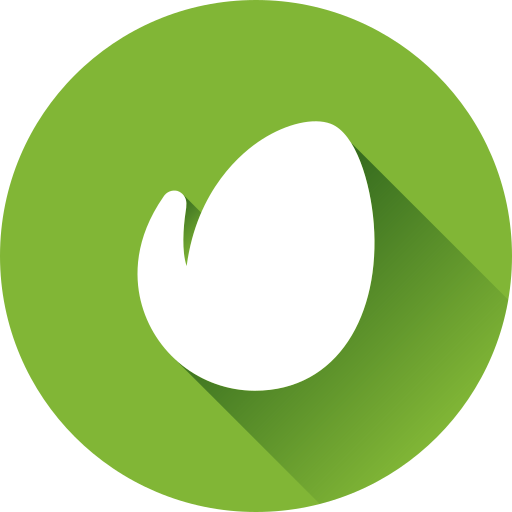

<!-- Common Project Tags:
badfon 
cli 
command-line 
console-applications 
dotnet 
goodfon 
images 
netframework 
netframework48 
scraper 
tool 
tools 
vbnet 
visualstudio 
wallpaper 
wallpaper-app 
wallpapers 
web-crawler 
web-crawling 
web-scraper 
web-scraping 
webcrawler 
webcrawling 
webscraper 
webscraping 
windows 
windows-app 
windows-application 
windows-applications 
 -->

  
  
  <h1>Goodfon Wallpaper Scraper</h1>

### A rule-based, multi-threaded console application designed to scrape and download original-resolution wallpapers from [Goodfon.com](https://www.goodfon.com/) website. 

------------------

    &nbsp;
    &nbsp;
    &nbsp;
    
    &nbsp;
    
   
   
    
    
    
    
    
    
   
    
    
    
    
    
    
   
   
    

------------------

## 👋 Introduction

**Goodfon Wallpaper Scraper** is a fully automated, rule-based wallpaper downloader built for mass-harvesting original-resolution wallpapers from the **Goodfon.com** website without manual intervention. By combining user-defined keyword filtering with automated session and IP management, the program handles catalog discovery and wallpaper extraction completely on autopilot, ensuring you only pull the content you actually want while handling all edge cases in the background.

## 🖼️ Screenshots

## 🎦 Videos

[Goodfon Wallpaper Scraper DEMO VIDEO](https://github.com/user-attachments/assets/b8abcb2d-a941-4061-b205-5e454e8d3db6)

*Note: This video showcases an early alpha version of the program. The terminal output layout, log performance indicators, or general UI structures might slightly differ from the current production codebase.*

## 👌 Features

* **Threaded Concurrency:** Processes catalog pages sequentially while spinning up to 24 concurrent worker tasks per page to validate, process, and download wallpapers simultaneously.
* **Smart Account Rotation:** Seamlessly manages multiple GoodFon accounts. Accounts are kept strictly in a browsing session state to navigate unrestricted un-censored (NSFW) indices, and are dynamically selected for downloading only when a direct IP request hits a `403 (Forbidden)` barrier requiring authorized rights.
* **Bypass Server Limits:** Incorporates an automated VPN control mechanism that monitors IP usage and proactively forces a VPN server rotation before hitting GoodFon's hard daily limit of 80 anonymous downloads per IP.
* **Advanced Content Filtering:** Avoids unwanted content using robust, case-insensitive keyword filtering rules (`Forbidden Keywords.txt`) across all resolved image URLs.
* **Duplication Guard:** Tracks download history across sessions via MD5 URL hashing, completely avoiding redundant requests or re-downloading existing local files.

## 📝 Requirements

- Microsoft Windows OS.
- [Proton VPN client for Windows (free or paid plan).](https://protonvpn.com/download)

## 🚀 Getting Started

1. Navigate to the **[Releases page](https://github.com/ElektroStudios/Goodfon-Wallpaper-Scraper/releases/latest)**.
2. Download the latest `.zip` archive or the `.exe` setup installer, depending on your preference.
3. If you downloaded the `.zip` archive, extract its contents to your preferred directory.
     
   If you downloaded the `.exe` file, run it and follow the installation wizard.
4. Run the executable file to launch the application.

Also, you can read a manual in HTML format by clicking [here](https://htmlpreview.github.io/?https://github.com/ElektroStudios/Goodfon-Wallpaper-Scraper/blob/main/Source/Goodfon%20Wallpaper%20Scraper/manual/Goodfon%20Wallpaper%20Scraper%20Manual.html).

## 💡 Tips

* **Bulk Account Creation:** You can use temporary mail services like [temp-mail.org](https://temp-mail.org/) to quickly register multiple user accounts on Goodfon in just a few minutes. 
* **Maximize Restricted Pulls:** Since every registered account grants you an individual allocation of 100 daily downloads for mature/restricted content, adding a batch of configured credentials to your `Accounts.json` file ensures a massive threshold of restricted assets can be downloaded concurrently during a single session.

## ⚠️ Limitations

* **Proton VPN Client Dependency:** While the program can technically interface with the free tier of the Proton VPN client for Windows, doing so is highly unstable. The free version imposes severe multi-minute cooldown penalties for server switching, which forces the scraper to halt or time out during a rotation cycle. For an uninterrupted automated experience capable of pulling tens of thousands of wallpapers in a matter of hours, **a paid Proton VPN plan is heavily recommended**.
* **Hard Single-Session Cap:** Without any running instance of Proton VPN, the scraper is strictly limited by the web-server's native restrictions: 80 daily downloads for guest IPs, or 100 downloads if a registered Goodfon account is provided.

## 🔄 Change Log

Explore the complete list of changes, bug fixes, and improvements across different releases by clicking [here](/Docs/CHANGELOG.md).

## 💪 Contributing

Your contribution is highly appreciated!. If you have any ideas, suggestions, or encounter issues, feel free to open an issue by clicking [here](https://github.com/ElektroStudios/Goodfon-Wallpaper-Scraper/issues/new/choose). 

Your input helps make this Work better for everyone. Thank you for your support! 🚀

## 💰 Beyond Contribution

This work is distributed for educational purposes and without any profit motive. However, if you find value in my efforts and wish to support and motivate my ongoing work, you may consider contributing financially through the following options:

| Platform | How to Support |
| :---: | :--- |
|  | **[Become my sponsor on GitHub](https://github.com/sponsors/ElektroStudios/)** You can show me your support by contributing any amount you prefer, and unlocking rewards! |
|  | **[Make a PayPal Donation](https://www.paypal.com/cgi-bin/webscr?cmd=_s-xclick&hosted_button_id=E4RQEV6YF5NZY)** You can donate to me any amount you like via PayPal. |
|  | **[Purchase my software at Envato's CodeCanyon](https://codecanyon.net/item/elektrokit-class-library-for-net/19260282)** If you are a .NET developer, you may want to explore **DevCase Class Library for .NET**, a huge set of APIs I have on sale. *It also contains all pieces of reusable code that you can find across the source code of my open-source works.* |

 

  <b>Your support means the world to me! Thank you for considering it! 🤗💗</b>

------------------

## 🏆 Credits

This work relies on the following resources: 

 - [.NET Framework](https://dotnet.microsoft.com/en-us/download/dotnet-framework)
 - [HtmlAgilityPack](https://html-agility-pack.net/)

## ⚠️ Disclaimer

This software and its associated repository are provided strictly on an "as is" basis, without warranties of any kind, whether express or implied. This includes, but is not limited to, any implied warranties of merchantability, reliability, or fitness for a particular purpose.

The authors and copyright holders assume no liability for any direct, indirect, incidental, or consequential damages—including data loss or system errors—arising from the use, misuse, or inability to use this software. You are solely responsible for determining the appropriateness of using this tool and assume all associated risks.

Furthermore, this project operates entirely independently. The utilization of any third-party libraries or components within this software does not imply any affiliation with, or endorsement or approval by, their respective original authors.

This software may interact with third-party services, websites, or platforms. It is the user's sole responsibility to ensure that such use complies with the applicable terms of service, laws, and regulations. The authors do not endorse, and are not responsible for, any misuse of this software to violate third-party terms of service or applicable law.

By using this software, you agree to indemnify and hold harmless the authors from any claims, damages, or liabilities arising from your use or misuse of it.

This project is licensed under the **Apache License, Version 2.0**. See the  [License](./LICENSE) file for details.
